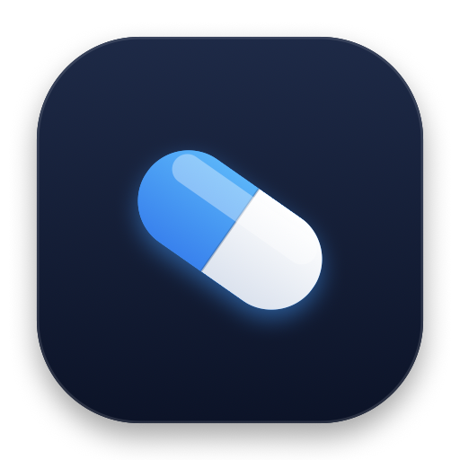
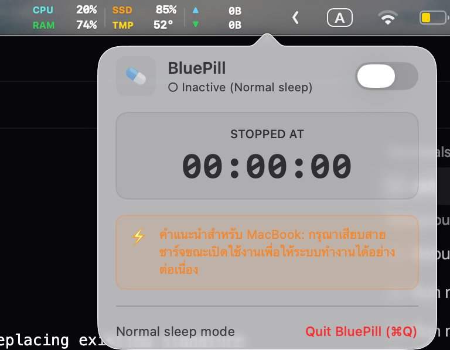

<p align="center">
  
</p>

# BluePill 

> **Lightweight macOS Menu Bar Keep-Awake Utility (`caffeinate -dis`)**  
> *โปรแกรมขนาดเล็กบนแถบเมนูบาร์สำหรับป้องกันเครื่อง Mac และหน้าจอดับ (เทียบเท่าคำสั่ง `caffeinate -dis`)*

[](https://apple.com/macos)
[-brightgreen.svg)]()
[]()
[]()

---

## 🇹🇭 ภาษาไทย (Thai)

### 📌 ภาพรวม (Overview)
**BluePill** เป็นโปรแกรมขนาดเล็ก (Native macOS Menu Bar App) ที่พัฒนาด้วยภาษา Swift และ SwiftUI โดยตรง ออกแบบมาเพื่อชิป **Apple Silicon (Mac M1 และใหม่กว่า)** โดยเฉพาะ ช่วยให้คุณสั่งให้ Mac และหน้าจอทำงานต่อเนื่อง ไม่ให้ดับหรือเข้าสู่โหมด Sleep ได้อย่างง่ายดายด้วยสวิตช์คลิกเดียวบนแถบเมนูบาร์ โดยไม่ต้องเปิด Terminal หรือพิมพ์คำสั่ง `caffeinate -dis` ค้างไว้อีกต่อไป

---

### 📸 ภาพตัวอย่างการใช้งาน (Screenshots)

<p align="center">
  <br>
  <em>แถบเมนูบาร์ขณะเปิดใช้งาน พร้อมแสดงเวลานับต่อเนื่องด้วยฟอนต์ Monospace ไม่ขยับสั่น</em>
</p>

<p align="center">
  <br>
  <em>หน้าต่างควบคุม Popover Card สไตล์โมเดิร์น พร้อมสวิตช์เปิด-ปิด และกล่องคำแนะนำ</em>
</p>

---

### ✨ คุณสมบัติเด่น (Key Features)

1. **ทำงานบนแถบเมนูบาร์ (Menu Bar Resident):**
   - รันในฐานะ Accessory Application (`LSUIElement = true`) ไม่มีไอคอน Dock มากวนใจ
   - ไอคอนเม็ดยาสีฟ้า-ขาว  สวยงาม คมชัดระดับ Retina บนแถบเมนูบาร์
2. **ระบบป้องกันเครื่องหลับแบบ Native IOKit:**
   - ทำงานเทียบเท่าคำสั่ง `caffeinate -dis` ครบทั้ง 3 มิติ:
     - ป้องกัน Display Sleep (`-d`)
     - ป้องกัน Idle Sleep (`-i`)
     - ป้องกัน System Sleep (`-s`)
   - ใช้ System Call โดยตรง จึงไม่เปลือง CPU (0% idle CPU) และกินแรมน้อยมาก (< 25 MB)
3. **ระบบนับเวลาอัจฉริยะ (Smart Elapsed Timer):**
   - **ตัวเลขไม่สั่น (Zero Jitter):** ใช้ฟอนต์ Tabular Monospaced Digits ทำให้ตัวเลขทุกตัวมีความกว้างคงที่เป๊ะ ไอคอนอื่นๆ บนเมนูบาร์จะไม่ขยับสั่นขณะเวลานับ
   - **รองรับการเปิดใช้งานระยะยาว:** 
     - ไม่เกิน 24 ชั่วโมง: แสดงแบบ `00:00:00`
     - ตั้งแต่ 24 ชั่วโมงขึ้นไป: แสดงจำนวนวันนำหน้า เช่น `1d 04:15:20`, `30d 12:00:00`, `365d 08:30:15`
   - **หยุดและรีเซ็ตตามสั่ง:** เมื่อปิดสวิตช์ เวลานับจะหยุดค้างไว้ที่ตัวเลขล่าสุด และเมื่อเปิดใหม่จะรีเซ็ตกลับเป็น `00:00:00` อัตโนมัติ
4. **หน้าต่างควบคุมสไตล์โมเดิร์น (Modern Popover Card):**
   - สวิตช์ Toggle เปิด/ปิด ขนาดใหญ่ พร้อมแถบสีเขียว
   - หน้าปัดนาฬิกาดิจิทัลขนาดใหญ่
   - กล่องแจ้งเตือนคำแนะนำสำหรับผู้ใช้ MacBook ให้เสียบสายชาร์จขณะเปิดใช้งานต่อเนื่อง
   - ปุ่มลัด **Quit BluePill (⌘Q)** สำหรับปิดโปรแกรม

---

### ⚙️ เงื่อนไขและพฤติกรรมในสถานการณ์ต่างๆ (Operational Conditions)

| สถานการณ์ | ผลลัพธ์และการทำงานของ BluePill |
| :--- | :--- |
| **เปิดเครื่องทิ้งไว้เฉยๆ (Idle)** | หน้าจอและระบบจะไม่ดับ และจะไม่หลับเด็ดขาดจนกว่าจะกดปิดสวิตช์ |
| **ผู้ใช้สั่ง Apple Menu  ➔ Sleep** | macOS จะให้สิทธิ์เจ้าของเครื่องเสมอ เครื่องจะเข้า Sleep ตามคำสั่ง แต่เมื่อปลุกเครื่องกลับขึ้นมา BluePill จะยังคงอยู่ในสถานะเปิด (ON) และนับเวลาต่อตามเวลาจริง |
| **พับฝาจอ MacBook (ไม่ต่อจอนอก)** | เครื่องจะเข้า Sleep เพื่อความปลอดภัย (ป้องกันเครื่องร้อนในกระเป๋า) และเมื่อเปิดฝาจอขึ้นมา BluePill จะกลับมาทำงานต่อเนื่องทันที |
| **พับฝาจอ MacBook (ต่อจอนอก + เสียบสายชาร์จ)** | ด้วยคำสั่ง `-s` (`PreventSystemSleep`) **MacBook จะไม่หลับ** สามารถใช้งานผ่านจอนอกได้ต่อเนื่องแม้พับฝาเครื่อง |
| **บังคับปิดโปรแกรม (Force Quit / `kill -9`)** | เคอร์เนล macOS (`powerd`) จะตรวจจับการปิดตัวของโปรเซส และจะ**ปลดการระงับการหลับทั้งหมดคืนให้ระบบโดยอัตโนมัติ**ทันที เครื่องจะกลับสู่โหมดประหยัดพลังงานตามปกติอย่างปลอดภัย 100% |
| **เปิดใช้งานต่อเนื่องนานข้ามเดือน/ปี** | ชนิดข้อมูลรองรับเวลานับได้สูงสุดถึง 292,000 ล้านปี ไม่มีปัญหาตัวเลขล้น (Integer Overflow) |

---

### 🛠️ วิธีการติดตั้งและใช้งาน (Installation & Commands)

โปรเจกต์นี้มี [Makefile](file:///Users/chanchai/workshop/BluePill/Makefile) สำหรับสั่งงานผ่าน Terminal ได้ทันที:

```bash
# คอมไพล์และติดตั้ง BluePill.app ไปยังโฟลเดอร์ /Applications
make install

# รันชุดแบบทดสอบอัตโนมัติ (Unit & Integration Tests 11/11 tests)
make test

# คอมไพล์ตัวแอปพลิเคชันสำหรับ Apple Silicon M1 (arm64)
make build

# เปิดใช้งานโปรแกรมทันที
make run

# ถอนการติดตั้งออกจากเครื่อง
make uninstall

# ล้างไฟล์คอมไพล์
make clean
```

---

### ⚠️ ข้อความปฏิเสธความรับผิดชอบ (Disclaimer & Limitation of Liability)

> **โปรดอ่านข้อความปฏิเสธความรับผิดชอบนี้อย่างละเอียดก่อนนำซอฟต์แวร์ไปใช้งาน:**
>
> 1. **การให้บริการตามสภาพจริง (AS IS):**  
>    ซอฟต์แวร์ **BluePill** นี้จัดทำขึ้นและเผยแพร่ให้ใช้งาน "ตามสภาพที่เป็นอยู่" (AS IS) และ "ตามที่มีอยู่" (AS AVAILABLE) โดยปราศจากการรับประกันใดๆ ไม่ว่าจะโดยชัดแจ้งหรือโดยปริยาย ซึ่งรวมถึงแต่ไม่จำกัดเพียง การรับประกันความเหมาะสมสำหรับวัตถุประสงค์เฉพาะ ความสมบูรณ์ ความถูกต้อง หรือการปราศจากข้อผิดพลาด
>
> 2. **การจำกัดความรับผิดชอบโดยสิ้นเชิง (No Liability):**  
>    **ผู้พัฒนาและผู้สร้างซอฟต์แวร์นี้ จะไม่รับผิดชอบต่อความเสียหาย ความสูญเสีย หรือข้อบกพร่องใดๆ ทั้งสิ้น ไม่ว่าจะเป็นทางตรง ทางอ้อม ค่าเสียหายต่อเนื่อง หรือความเสียหายพิเศษใดๆ ที่เกิดขึ้นจากการดาวน์โหลด ติดตั้ง ใช้งาน หรือไม่สามารถใช้งานซอฟต์แวร์นี้ได้ ไม่ว่าจะเกิดจากกรณีใดๆ ก็ตาม**
>
> 3. **ความเสี่ยงและการยอมรับของผู้ใช้งาน (User Risk):**  
>    การเปิดใช้งานคำสั่งป้องกันหน้าจอดับและป้องกันเครื่องหลับ (`caffeinate`) เป็นเวลานาน อาจส่งผลให้เกิดความร้อนสะสมของอุปกรณ์ (Device Overheating), การเสื่อมสภาพของแบตเตอรี่จากการเสียบสายชาร์จหรือคายประจุอย่างต่อเนื่อง, การเกิดภาพค้างบนหน้าจอ (Screen Burn-in / Image Retention), หรือการสูญหายของข้อมูลจากการใช้พลังงานจนหมด **ผู้ใช้งานต้องยอมรับความเสี่ยงทั้งหมดที่อาจเกิดขึ้นกับฮาร์ดแวร์ ซอฟต์แวร์ และข้อมูลของท่านด้วยตนเองแต่เพียงผู้เดียว**

---
---

## 🇬🇧 English

### 📌 Overview
**BluePill** is a lightweight, native macOS menu bar utility built in Swift and SwiftUI specifically optimized for **Apple Silicon (Mac M1 and newer)**. It provides a simple, tactile one-click toggle to keep your Mac and display awake, functioning identically to the native macOS `caffeinate -dis` command, without the need to keep Terminal windows open.

---

### 📸 Screenshots

<p align="center">
  <br>
  <em>Menu Bar resident mode with active zero-jitter elapsed timer</em>
</p>

<p align="center">
  <br>
  <em>Modern popover card with one-click toggle and MacBook battery advisory</em>
</p>

---

### ✨ Key Features

1. **Menu Bar Resident:**
   - Runs as an accessory app (`LSUIElement = true`) with zero Dock clutter.
   - Beautiful Retina-ready custom Blue & White Pill icon  in the menu bar.
2. **Native IOKit Sleep Prevention Engine:**
   - Emulates `caffeinate -dis` natively via Apple IOKit Power Assertions:
     - Prevent Display Sleep (`-d`)
     - Prevent Idle Sleep (`-i`)
     - Prevent System Sleep (`-s`)
   - Uses zero idle CPU (0%) and minimal memory footprint (< 25 MB).
3. **Smart Tabular Elapsed Timer:**
   - **Zero Menu Bar Jitter:** Uses `NSFont.monospacedDigitSystemFont` to guarantee identical character widths, preventing neighboring menu bar icons from shaking or shifting.
   - **Multi-Day Support:** Automatically formats duration as `Xd HH:MM:SS` when runtime reaches or exceeds 24 hours (e.g., `1d 04:15:20`, `30d 12:00:00`, `365d 08:30:15`).
   - **Freeze & Reset on Demand:** Freezes on OFF, resets to `00:00:00` upon next activation.
4. **Modern Popover Card:**
   - Large tactile Toggle Switch with native green tint.
   - Digital monospaced clock display.
   - Integrated MacBook AC charger recommendation banner.
   - Standard **Quit BluePill (⌘Q)** shortcut.

---

### ⚙️ Operational Conditions & System Behaviors

| Scenario | BluePill & macOS Behavior |
| :--- | :--- |
| **Idle System** | Mac display and system will stay completely awake indefinitely until toggled OFF. |
| **Manual User Sleep ( ➔ Sleep)** | macOS honors the user's explicit command and enters sleep. Upon waking, BluePill remains ON and continues tracking time based on actual wall-clock elapsed time. |
| **Lid Closed (Without External Display)** | System suspends display and enters safety sleep to prevent heat accumulation. Upon opening the lid, BluePill resumes active keep-awake enforcement immediately. |
| **Lid Closed (With External Display & AC Power)** | Thanks to the `-s` assertion, the Mac operates seamlessly in Clamshell mode without sleeping. |
| **Force Quit / Process Crash (`kill -9`)** | The macOS kernel (`powerd`) automatically releases all registered IOKit power assertions associated with the deceased PID. System sleep behavior returns to normal immediately with zero orphaned processes. |
| **Long-Term Execution (Months / Years)** | 64-bit integer timer supports over 292 billion years of runtime without arithmetic overflow. |

---

### 🛠️ Building & Installation

Use the provided [Makefile](file:///Users/chanchai/workshop/BluePill/Makefile) for automated commands:

```bash
# Build fresh release, uninstall old copy, install to /Applications, and clean artifacts
make install

# Run automated Unit & Integration tests (11/11 passing)
make test

# Build standalone BluePill.app bundle
make build

# Launch the app immediately
make run

# Uninstall from /Applications
make uninstall

# Clean build artifacts
make clean
```

---

### ⚠️ Disclaimer & Limitation of Liability

> **PLEASE READ THIS DISCLAIMER CAREFULLY BEFORE USING THIS SOFTWARE:**
>
> 1. **"AS IS" WARRANTY DISCLAIMER:**  
>    **BluePill** is provided and licensed **"AS IS"** and **"AS AVAILABLE"**, WITHOUT WARRANTY OF ANY KIND, EXPRESS OR IMPLIED, INCLUDING BUT NOT LIMITED TO THE WARRANTIES OF MERCHANTABILITY, FITNESS FOR A PARTICULAR PURPOSE, AND NON-INFRINGEMENT.
>
> 2. **COMPLETE LIMITATION OF LIABILITY:**  
>    **IN NO EVENT SHALL THE AUTHORS, DEVELOPERS, OR COPYRIGHT HOLDERS BE LIABLE FOR ANY CLAIM, DAMAGES, LOSSES, OR OTHER LIABILITY, WHETHER IN AN ACTION OF CONTRACT, TORT, OR OTHERWISE, ARISING FROM, OUT OF, OR IN CONNECTION WITH THE SOFTWARE OR THE USE OR OTHER DEALINGS IN THE SOFTWARE.**
>
> 3. **USER ASSUMPTION OF RISK:**  
>    Keeping a computer awake or display active for extended periods may cause excessive heat accumulation, battery degradation, display burn-in or image retention, unexpected battery exhaustion, or data loss. **YOU EXPRESSLY ACKNOWLEDGE AND AGREE THAT THE ENTIRE RISK AS TO THE USE, RESULTS, AND PERFORMANCE OF THIS SOFTWARE IS ASSUMED SOLELY BY YOU.**

---
*Created with ❤️ for macOS Apple Silicon.*
